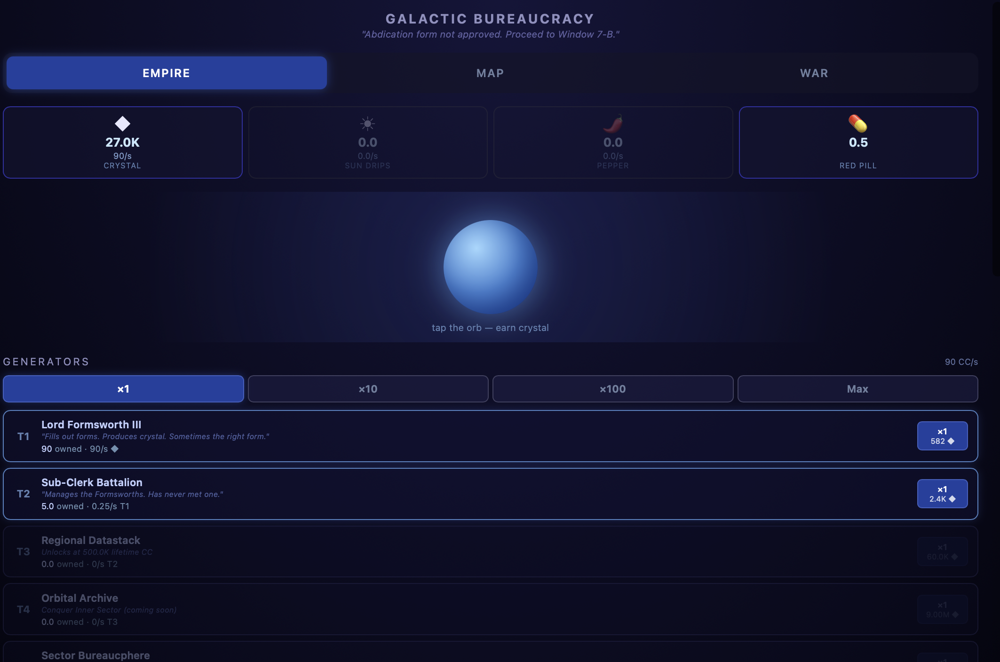
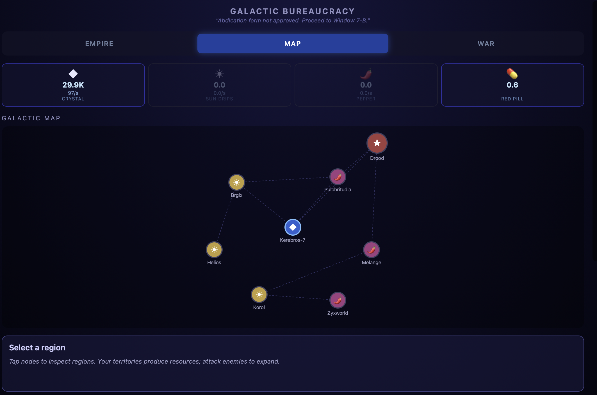
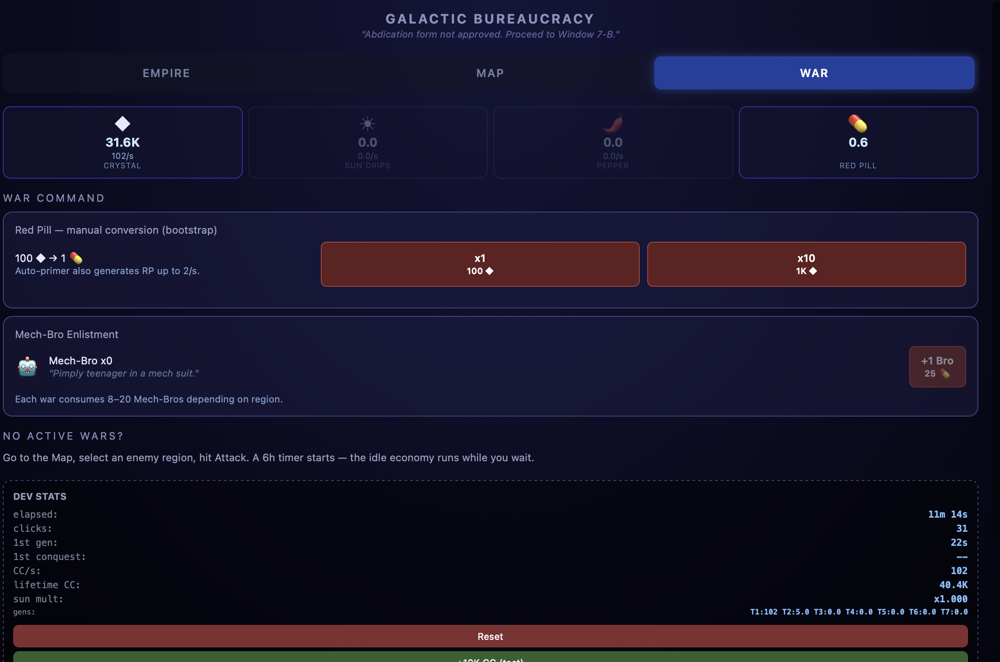

# Galactic Bureaucracy

A mobile idle/incremental game built as a sci-fi bureaucracy parody. You play as a Galactic Emperor whose empire runs on absurd paperwork — vassals automate production, compound generator chains grow faster than anyone can control, and conquest is gated by fleet capacity and Mech-Bros in ill-fitting suits.

---

## Play

**Live demo:** `<PAGES_URL_BURAYA>`

Or open `assets/game.html` directly in any browser — no build step required.

---

## Screenshots

| Empire | Map | War |
|---|---|---|
|  |  |  |

---

## Features

**Compound generator chain** — 7 tiers from Lord Formsworth III (produces Cyber Crystal) up to The Infinite Ledger. Each tier produces fractional units of the tier below; only Tier 1 mints CC. This creates exponential growth that accelerates on its own, even while idle. Tiers 1–3 unlock via CC milestones; Tiers 4–7 unlock through sector conquest.

**Upgrade tree** — three branches available from the start: Crystal Overclock (+10% CC/level), Expedited Warfare (−5% war timer/level), Bulk Enlistment (−4% Red Pill cost/level). Cost doubles per level; there's always something affordable.

**8-region galactic map and war system** — regions are connected nodes; you can only attack regions adjacent to territory you own. Each war runs on a timer and consumes Mech-Bros (enlisted with Red Pill). Multiple wars run in parallel, bounded by your fleet's uncommitted capacity.

**Save + offline accrual** — state saves to `localStorage` every 30 seconds and on page hide. On return, the game calculates what the compound chain would have produced offline, applies it at 50% efficiency in 1-hour sub-steps (up to 8 hours max), and shows you what you earned.

**EN / TR interface** — all user-visible strings live in a `STRINGS` table with `en` and `tr` keys. The active language is the `lang` variable (default `'en'`). To use Turkish, change `var lang = 'en'` to `var lang = 'tr'` in `assets/game.html` — there is no runtime toggle yet.

---

## Economy design

The balance model lives in `design/economy-model/`:

- **`galactic_bureaucracy_economy.xlsx`** is the source of truth. All tunable constants are in the Assumptions sheet (blue cells). Edit here first.
- **`playthrough_sim.py`** reads the spreadsheet live and simulates a 40-day playthrough across multiple sessions, reporting CC/s progression, conquest milestones, prestige timing, and health flags. It's the primary validation tool — change a number in the sheet, re-run the sim, check the pacing, then port to the JS `CONFIG`.
- **`ECONOMY-BALANCE.md`** documents every constant, what it affects, and how to tune it safely.

**Running the sim:**
```bash
pip install openpyxl
cd design/economy-model
python playthrough_sim.py 40   # simulate 40 days
```

### Chain verification

`tools/reference_chain.py` and `tools/verify_economy.js` run the same deterministic scenario — formsworth=50, subclerk=10, datastack=5, all others=0, 3600 seconds at dt=10s steps — through (respectively) a pure-Python reference implementation and the real `advanceCompound` + `CONFIG` extracted from `assets/game.html`. Results are compared at 1e-6 relative tolerance.

```bash
python3 tools/reference_chain.py   > /tmp/ref.json
node    tools/verify_economy.js    > /tmp/js.json
# All 8 keys pass at 0.00e+00 relative difference
```

---

## Roadmap (not yet implemented)

The full design target — 54 conquerable regions across 5 sectors, 5 ship classes, faction capitals with unique vassal rewards, prestige (Abdication), fleet range hard-gates, and a Dark Matter endgame — is fully specified in [`design/economy-model/ARCHITECTURE.md`](design/economy-model/ARCHITECTURE.md) and validated by the simulator. None of it is in the game code yet.

---

## Run locally

**Browser (instant):**
```
open assets/game.html
```

**Expo (iOS / Android):**
```bash
npx expo start
```
Requires Node and the Expo Go app or a simulator.

---

## How it was built

The prototype was written with Claude Code in a few hours in May 2026. In October 2026 it was migrated to the compound economy model and polished further, also with Claude Code. Most of the workflow was: describe what the economy should feel like, let the sim validate it, then implement in JS. Claude Code handled the mechanical coding; the design decisions (balance numbers, feature order, what to cut) were all manual calls.

---

## Known limitations

- **Expo WebView save persistence is untested.** The app loads `game.html` as an HTML string via `source={{ html }}`, which gives the WebView an anonymous origin. `localStorage` works in browser and may work with `domStorageEnabled={true}`, but whether saves persist between app launches on a real device has not been verified.
- **No runtime language toggle.** EN/TR switching requires editing the `lang` variable in the source file.
- **No store build.** EAS Build and store submission have not been attempted.
